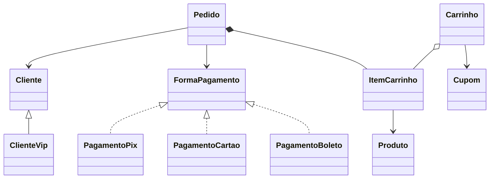

# Relatório técnico - ShopOnline

**iCEV - Instituto de Ensino Superior**

Engenharia de Software - 2º período

Disciplina: Programação Orientada a Objetos | Avaliação P2

Professor: Samuel Oliveira | Revisão: 21 de novembro de 2026

**Equipe:** João Guilherme Monteiro; Maria Vitória Salgado; Lucas Silveira; Gabriel Buhatem; Lavynne Marianne.

## 1. Introdução, escopo e execução

O ShopOnline é uma aplicação de console para gerenciar uma loja virtual. O programa cadastra produtos e clientes, monta carrinhos, aplica promoções, simula pagamentos e registra pedidos. Também acompanha estoque, níveis de fidelidade e créditos de cashback.

O escopo funcional segue o enunciado do ShopOnline fornecido pelo professor em imagens: catálogo e estoque; carrinho e pedidos; cashback e pontuação; descontos VIP e cupons; pagamentos e relatórios. CSV, organização em camadas, testes sem bibliotecas externas e roteiro de demonstração são decisões da equipe para implementar e verificar esse escopo. Os guias antigos da equipe são documentos de planejamento, não substitutos do enunciado.

### Execução e ambiente

É necessário JDK 17 ou superior. Na raiz do projeto, `./run.sh` compila e inicia o menu em macOS/Linux. O diretório de trabalho da IDE também deve ser a raiz, pois a aplicação usa caminhos relativos em `data/`. O script `run.bat` está disponível para Windows, mas não foi executado nesta revisão.

```bash
mkdir -p out
find src -name '*.java' -print0 | xargs -0 javac --release 17 -encoding UTF-8 -d out
java -cp out Main
```

O modo `java -cp out Main --demo` executa uma compra automática usando os produtos P01 e P02 e o cliente C02. Ele modifica os dados e precisa de estoque disponível. O cupom BEMVINDO10 é usado somente se estiver válido para o cliente. Antes de ensaios, deve-se copiar a pasta `data/` para preservar o estado original.

### Navegação e atendimento aos requisitos

| Requisito do professor | Implementação acessível |
| --- | --- |
| Produtos, cadastro e estoque | Menu 1: cadastro, consulta, reposição e alerta abaixo de 5 unidades. |
| Clientes e promoção VIP | Menu 2: cadastro comum/VIP; carrinho aplica 10% em produtos elegíveis. |
| Carrinho e cupons | Menu 3: itens, quantidades, cupom percentual/fixo e checkout. |
| Pagamentos e status | Checkout: PIX/cartão/boleto; menu 4: consulta, avanço e cancelamento. |
| Fidelidade, cashback e relatórios | Menu 5 e checkout: pontos, níveis, resgate, receitas e quantidades vendidas. |

A validação técnica descrita neste relatório se refere à cópia local revisada. Publicação, integração remota e envio acadêmico são etapas distintas.

<!-- pagebreak -->

## 2. Modelagem orientada a objetos

A estrutura separa entidades em `model`, armazenamento em `repository`, coordenação das operações em `service` e interação em `view`. O `Main` monta as dependências e inicia o menu. As coleções mantêm os registros e as associações em memória durante a execução.



### Abstração e responsabilidades

`Produto` reúne descrição, preço, estoque e participação em promoção VIP. `Cliente` reúne identificação, nome, e-mail, pontos e saldo. `Carrinho` mantém os itens de uma compra ainda não concluída, enquanto `Pedido` registra os valores e o estado da venda. Os serviços coordenam operações que envolvem mais de uma entidade e seus arquivos.

### Encapsulamento

Os atributos são privados. O cadastro de clientes valida identificação, nome e e-mail, impede IDs duplicados e diferencia cadastro de atualização. `ItemCarrinho` rejeita produto ausente e quantidades não positivas. O checkout revalida estoque e cupom antes de alterar os registros. O pedido fornece cópias dos itens para proteger quantidades e preços históricos de alterações externas.

### Herança e polimorfismo

`ClienteVip extends Cliente` reutiliza dados, construtores e validações, chamando `super(...)`. A subclasse sobrescreve `isVip()` e `calcularDescontoVip(Produto)`. Uma referência `Cliente` pode apontar para um VIP: o método executado depende do objeto. Em cliente comum, o desconto é zero; no VIP, equivale a 10% do preço unitário apenas quando o produto está marcado para a promoção.

`FormaPagamento` define `getNome()`, `calcularValorFinal(double)` e `getDescricao()`. PIX, cartão e boleto implementam o contrato. O serviço chama o cálculo pela interface; as regras de cada pagamento permanecem nas respectivas classes.

<!-- pagebreak -->

## 3. Carrinho, promoções e cupons

O carrinho agrega itens por produto, soma subtotais e permite remover quantidades ou limpar a compra. O menu verifica o estoque acumulado ao adicionar unidades; o checkout faz nova verificação antes da baixa. O pedido recebe uma cópia dos itens, preservando quantidade e preço de venda.

O desconto VIP é calculado por produto elegível e multiplicado pela quantidade. O cupom pode ser percentual ou fixo e incide sobre o subtotal. Há apenas um cupom aplicado de cada vez. Um cupom fixo é limitado ao subtotal; a soma com o desconto VIP também não pode produzir valor negativo a pagar.

### Uso único, validade e persistência

`Cupom` registra os IDs dos clientes que já o utilizaram. O serviço valida esse histórico no checkout, inclusive contra o cadastro persistido, para impedir reuso mediante reconstrução do objeto. O cupom é consumido somente no fluxo de confirmação; falhas detectadas durante a compra tentam restaurar sua situação anterior.

A validade inclui o dia informado; uma data em branco representa cupom sem prazo. No cadastro pelo menu, data inválida interrompe o cadastro, em vez de criar cupom sem validade por engano. Percentuais devem estar acima de zero e até 100; descontos fixos devem ser positivos. Os valores são normalizados para duas casas com HALF_UP; valores que arredondariam para zero são rejeitados.

O CSV novo usa `codigo;tipo;valor;dataValidade;clientesUtilizados`. A última coluna contém IDs separados por vírgula. IDs como TRUE e FALSE são preservados como clientes no formato novo. No formato antigo, com a coluna `utilizado`, `false` significa ausência de uso e `true` mantém um bloqueio global, preservado pelo marcador `*` ao salvar. Como o arquivo antigo não identifica o comprador, não se inventa um histórico por cliente.

### Ordem de cálculo e exemplo

A implementação aplica: subtotal, descontos VIP e cupom, limite mínimo zero, regra do pagamento e resgate opcional de cashback. Essa ordem é uma decisão da equipe para um detalhe que o enunciado não especifica.

| Etapa | Exemplo de compra |
| --- | --- |
| Produto promocional, uma unidade | R$ 250,00 |
| Desconto VIP de 10% | R$ 25,00 |
| Cupom de 10% do subtotal | R$ 25,00 |
| Base após VIP e cupom | R$ 200,00 |
| PIX com 5% de desconto | R$ 190,00 |
| Resgate de saldo anterior | R$ 120,00 |
| Valor final a pagar | R$ 70,00 |

O teste do console reproduz esse exemplo. A suíte do módulo de carrinho e cupons passou em 30 verificações, incluindo remoção parcial, validade, uso por clientes diferentes, persistência e total não negativo. As regressões adicionais verificam reuso após reinício e divergência entre cupom aplicado e cadastro.

<!-- pagebreak -->

## 4. Pagamentos, pedidos e persistência

Os pagamentos são simulados. `PagamentoPix` reduz o valor em 5%; `PagamentoCartao` mantém o total e aceita de uma a dez parcelas sem juros; `PagamentoBoleto` mantém o total. A confirmação apresenta o pedido e o cashback gerado, sem comunicação com serviços bancários.

O checkout verifica carrinho, pagamento, estoque e duplicidade de ID antes de persistir a venda. IDs gerados pelos menus usam UUID. Após o sucesso, o carrinho é limpo e o pedido pode ser consultado e administrado no menu 4.

### Estados e cancelamento

```text
EM_PROCESSAMENTO -> ENVIADO -> ENTREGUE
        |
        +----------> CANCELADO
```

O avanço é sequencial. Um pedido enviado, entregue ou já cancelado não pode ser cancelado. O cancelamento permitido devolve as quantidades ao estoque e persiste o novo status. Repetir a operação não duplica a reposição. O relatório mantém o registro do cancelado, mas o exclui das receitas e unidades vendidas.

Na versão atual, o cancelamento não desfaz pontos, cashback gerado ou saldo resgatado. O uso de cupom também permanece registrado. Essa limitação é apresentada expressamente porque o enunciado fornecido detalha a devolução de estoque, mas não define o estorno dos benefícios.

### Arquivos e recuperação de falhas

| Arquivo | Informação persistida |
| --- | --- |
| produtos.csv | ID, nome, descrição, preço, estoque e promoção VIP. |
| clientes.csv | ID, nome, e-mail, pontos, saldo de cashback e indicador VIP. |
| cupons.csv | Código, tipo, valor, validade e clientes que utilizaram. |
| pedidos.csv | ID, cliente, subtotal, desconto, total, pagamento, status, data e cashback gerado. |
| itens_pedidos.csv | ID do pedido, produto, quantidade e preço unitário da venda. |

Os arquivos usam UTF-8, separação por ponto e vírgula e decimais com ponto. Escritas usam arquivos temporários antes da substituição do destino. Se o registro de pedido falhar após gravar seus itens, a implementação tenta restaurar o arquivo anterior de itens. O checkout também tenta recompor estoque, pontos, saldo e uso do cupom nas falhas detectadas. Erros de compensação são associados à exceção original.

Essas medidas não equivalem a uma transação de banco de dados: queda de energia ou acesso concorrente podem interromper a atualização entre arquivos. O uso previsto é uma instância local por vez. O histórico do cartão não guarda parcelas; ao reabrir, o tipo e o valor são mantidos, mas a descrição é reconstruída com uma parcela. A reconstrução de pedidos depende de produtos e clientes ainda existentes no cadastro.

<!-- pagebreak -->

## 5. Fidelidade, relatórios e contribuições

O programa distingue a categoria VIP do nível de fidelidade. A primeira habilita desconto nos itens promocionais; o segundo depende dos pontos e define a taxa de cashback.

| Nível | Pontos acumulados | Cashback |
| --- | --- | --- |
| Bronze | Até 499 | 2% |
| Prata | De 500 a 1.499 | 5% |
| Ouro | A partir de 1.500 | 8% |

Compras com valor final acima de R$ 100 geram a parte inteira de um ponto a cada R$ 10. R$ 100 não gera pontos; R$ 110 gera 11. Na implementação, a base é o valor após descontos, pagamento e resgate de saldo, e o cashback usa o nível anterior à pontuação da compra atual. O crédito pode ser gerado mesmo em compras que não atingem o limite para ganhar pontos.

O resgate é opcional e não pode exceder o saldo existente nem o valor a pagar. O novo cashback é arredondado para centavos e disponibilizado para compras futuras. No exemplo da seção 3, um cliente Ouro paga R$ 70 e recebe R$ 5,60 de novo cashback; como o valor final não supera R$ 100, não ganha novos pontos.

### Relatório de vendas

`VendaService.exibirRelatorioVendas()` consulta os pedidos persistidos e apresenta registros, quantidades vendidas por produto e receitas. Também calcula pedidos válidos e ticket médio, recurso adicional adotado pela equipe. Pedidos cancelados aparecem no histórico, mas não participam dessas somas. A consulta após reinício é verificada por teste com processos separados.

### Distribuição de responsabilidades

| Integrante | Frente acordada e componentes |
| --- | --- |
| João Guilherme Monteiro | Produtos, estoque e persistência base: Produto, EstoqueService, ProdutoRepository, inicialização e scripts. |
| Maria Vitória Salgado | Clientes, herança VIP e validações: Cliente, ClienteVip, ClienteRepository e MenuClientes. |
| Lucas Silveira | Carrinho, promoções e cupons: Carrinho, ItemCarrinho, Cupom, CupomRepository e MenuCarrinho. |
| Gabriel Buhatem | Pagamentos, pedidos e cancelamento: FormaPagamento, implementações, Pedido, PedidoRepository e PedidoService. |
| Lavynne Marianne | Fidelidade, cashback, relatórios e organização do menu: NivelFidelidade, FidelidadeService, VendaService e MenuPrincipal. |

A tabela registra a divisão acordada pela equipe, e não uma medição de autoria linha a linha. A revisão local conectou os módulos, reaproveitou a implementação de carrinho e cupons e acrescentou correções e verificações de integração. O fluxo de publicação combinado usa branches individuais, Pull Requests para developer e integração validada em main.

A avaliação técnica do trabalho mostra a importância de testar as fronteiras entre módulos: testes de entidades isoladas não detectavam a chamada incompatível do menu nem o relatório que ignorava pedidos após reiniciar. Os testes de checkout e console foram necessários para verificar o comportamento integrado.

<!-- pagebreak -->

## 6. Verificação, limites e referências

A revisão de 21/11/2026 compilou todos os fontes com JDK 26.0.2.1, `javac --release 17 -encoding UTF-8`. As 12 classes de verificação passaram em cópia temporária. A opção `--release 17` verifica compatibilidade de compilação; não foi realizada execução em uma JVM 17. O script run.sh também compilou e encerrou o menu com sucesso.

| Verificação | Resultado e cobertura |
| --- | --- |
| VerificacaoCadastroCliente | Passou: validações de clientes comuns/VIP, pontos e saldo iniciais. |
| VerificacaoCadastroRepositorioCliente | Passou: duplicidade, gravação, leitura e atualização. |
| VerificacaoDescontoVip | Passou: 10%, centavos e produtos sem promoção. |
| VerificacaoFalhaGravacaoClientes | Passou: falhas de escrita e recuperação. |
| VerificacaoLeituraClientes | Passou: registros inválidos, preservação e recarga. |
| VerificacaoMenuClientes | Passou: navegação, cadastro comum/VIP e listagem. |
| VerificacaoModuloJoao | 8 verificações aprovadas de produtos e estoque. |
| VerificacaoModuloLucas | 30 verificações aprovadas de carrinho e cupons. |
| VerificacaoModuloGabriel | 26 verificações aprovadas de pagamentos e pedidos. |
| VerificacaoIntegracaoGabriel | 27 verificações aprovadas de checkout, persistência e cancelamento. |
| VerificacaoCorrecoesEntrega | 12 casos aprovados de regressões e recuperação de falhas. |
| VerificacaoFluxoConsole | Passou: compra integrada, reinício, relatório e cancelamento. |

Para repetir as verificações, use os comandos de cópia temporária do README. As classes antigas de produtos e cupons criam arquivos relativos a data/; por isso, a bateria completa deve rodar na cópia, mesmo que outras classes já isolem seus próprios arquivos. Os CSVs originais foram comparados por SHA-256 e permaneceram idênticos após a validação.

### Limites de validação e uso

Não foram realizados testes no Windows, concorrência entre instâncias nem interrupção por queda de energia. Pagamentos são simulações. O histórico não preserva a quantidade de parcelas e depende dos cadastros referenciados. O cancelamento mantém os benefícios já movimentados, conforme descrito na seção 4. A leitura de produtos ignora linhas inválidas com aviso; elas devem ser corrigidas antes de qualquer nova gravação.


### Referências utilizadas

- Enunciado do sistema ShopOnline fornecido pelo professor, apresentado em imagens nesta revisão.
- Código-fonte e classes de verificação do projeto ShopOnline, revisados em 21/11/2026.
- Guia_Geral_Equipe_ShopOnline.pdf e Divisao_Tarefas_P2.pdf: distribuição de frentes, organização da equipe e estrutura planejada para o relatório.
- README.md e relatorio-decisoes.md atualizados para a mesma versão local.
